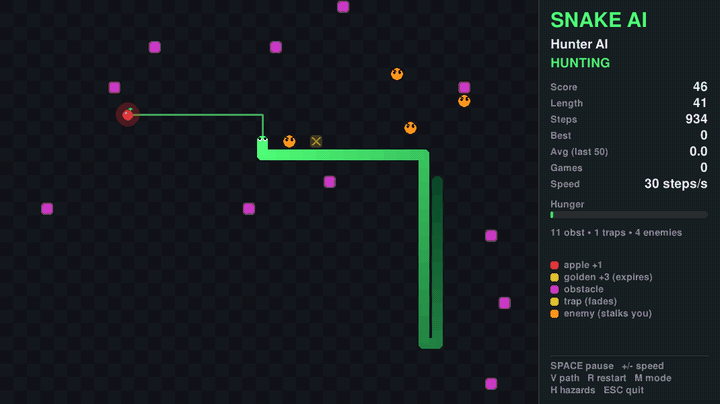
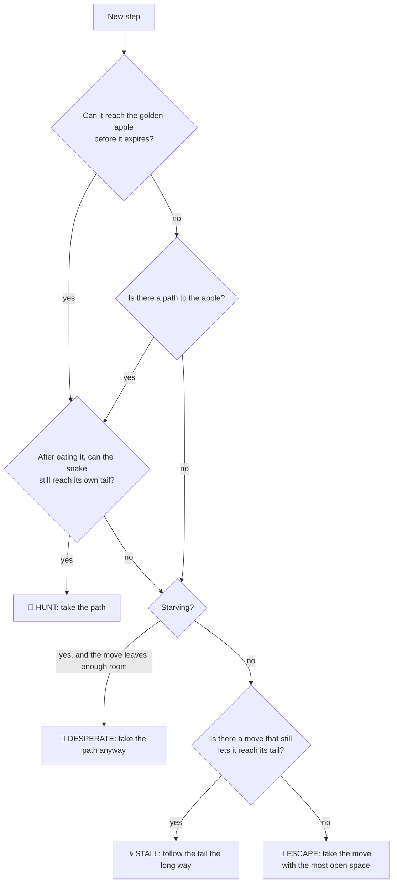
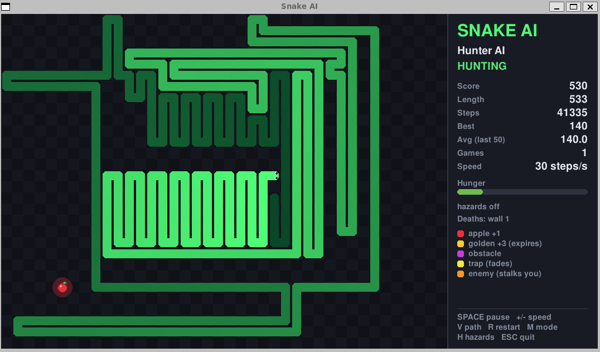

<div align="center">

# 🐍 Snake AI

**A snake that plans its moves, plus a neural network that evolves on its own to play the same game.**

[](https://www.python.org/)
[](https://www.pygame.org/)
[](https://numpy.org/)
[](LICENSE)



*The Hunter AI moving between obstacles, fading traps and enemies that chase it. The thin line is the path it plans to take.*

</div>

---

## ✨ Highlights

- 🎯 **Hunter AI**: plans a path to the food, and before taking it, checks that it could still reach its own tail after eating.
- 🧠 **Neural AI**: a small network evolved by a genetic algorithm, trained in parallel on every CPU core.
- 🕹️ **Human mode**: you play the same game with the keyboard.
- ☠️ **The arena gets harder as you score**: permanent obstacles, traps that fade away, enemies that move and sometimes chase you, and golden apples worth more that expire fast.
- 📊 **Headless benchmark mode** for testing any AI over hundreds of seeded games.
- 🪶 **Small**: one Python file, and only `numpy` and `pygame` as dependencies.

## 🚀 Quick start

```bash
git clone https://github.com/RandomArray/snake-ai.git
cd snake-ai
python3 -m venv .venv && source .venv/bin/activate
pip install -r requirements.txt
python3 snake.py
```

## 🎮 Modes

| Command | What it does |
|---|---|
| `python3 snake.py` | Watch the **Hunter AI** |
| `python3 snake.py --mode neural` | Watch the trained **neural network** (a trained brain is included) |
| `python3 snake.py --mode human` | Play it yourself with the arrow keys or WASD |
| `python3 snake.py --mode train` | Evolve the neural network headless on all cores; stop with `Ctrl+C`, and it picks up where it left off next time |
| `python3 snake.py --mode benchmark --agent hunter` | Play many headless games and print the stats |

**Options:** `--no-hazards` (classic snake) · `--speed N` · `--seed N` · `--games N` · `--generations N`

**In-game keys:** `SPACE` pause · `+`/`-` speed · `V` path overlay · `M` cycle mode · `H` hazards on/off · `R` restart · `ESC` quit

## 🗺️ The arena

| | Item | Behaviour |
|---|---|---|
| 🍎 | **Apple** | +1 point, grows the snake |
| 🌟 | **Golden apple** | +3 points, disappears after 90 steps |
| 🟪 | **Obstacle** | One more every 3 apples. Never placed where it would cut off part of the board |
| ⚠️ | **Trap** | Appears every 5 apples, fades away after 220 steps |
| 🟠 | **Enemy** | One more every 7 apples. Wanders, and sometimes moves toward your head |
| 🍽️ | **Hunger** | If the snake goes too long without eating, it starves |

## 🧠 How the Hunter thinks



A few details that make it work:

- **Path search that accounts for timing.** A body segment *i* cells from the tail clears its square in *i* moves. So the planner can route through squares that are body *now* but will be empty by the time the head gets there.
- **Practice run before eating.** For every path to food, it imagines the snake after eating. If that imagined snake couldn't reach its own tail, it doesn't commit, so it never traps itself.
- **Keeps clear of enemies.** It first plans as if each enemy might step one square in any direction, and only drops that caution when nothing else works.
- **Following the tail the long way** buys time for the body to clear, when going straight for the food isn't safe yet.

<div align="center">


*Classic mode (`--no-hazards`): length 533 and still going.*
</div>

## 🧬 How the neural AI learns

The network (25 inputs → 24 tanh hidden units → 3 outputs) picks **go straight, turn right, or turn left**. Instead of raw pixels, for each of the 3 moves it gets what a good player would think about:

> Is this move deadly? · How much room will I have? · Can I still reach my tail? · Is this the shortest way to the apple or the golden apple? · Are enemies nearby?

…plus four overall values: snake length, how hungry it is, and the direction to the apple (as sine and cosine of the angle).

Training uses a genetic algorithm:
- Every agent plays the **same** seeded games, so they're compared fairly.
- The best agents survive into the next generation unchanged.
- New agents are made by picking parents from small random groups (tournament selection), mixing their weights, and adding random noise. The amount of noise shrinks when training is improving and grows when it stalls.
- Before a generation's champion is saved, it plays extra games on new seeds, so one lucky run doesn't count.

Progress is saved to `neural_brain.npz` / `neural_state.json`. Each `--mode train` run starts from the saved brain.

## 📊 Benchmarks

The board has 40 × 30 = 1,200 squares. Results from `--mode benchmark`, with games run in parallel:

| AI | Mode | Games | Avg score | Median | Best | Notes |
|---|---|---:|---:|---:|---:|---|
| **Hunter** | hazards | 32 | **239** | 246 | 453 | Average length 191 |
| **Hunter** | classic | 16 | **612** | 611 | 638 | **Never died.** All 16 games hit the 50,000-step limit at about half-board length |
| Neural (gen 33) | hazards | 32 | 79 | 77 | 118 | Improves the longer you train it |
| Neural (gen 33) | classic | 16 | 87 | 90 | 127 | |

Reproduce:

```bash
python3 snake.py --mode benchmark --agent hunter --games 32 --seed 1000
```

## 📁 Project layout

```
snake.py            # everything: game, planner, Hunter AI, neural AI, trainer, renderer, CLI
neural_brain.npz    # trained network weights (included, ~7 KB)
neural_state.json   # training progress, so training can resume
docs/               # README media
```

## 📜 License

[MIT](LICENSE) © 2026 Mike Johanning
